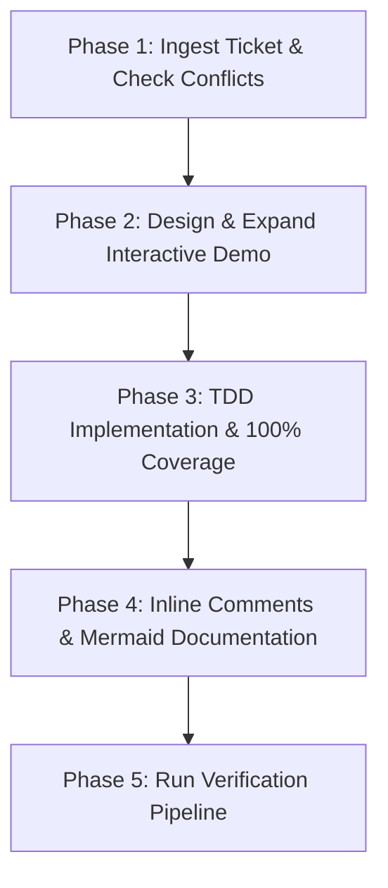

# Implement GitHub Feature

Automates the structured, end-to-end implementation of functional feature tickets from GitHub issues for the `ngx-magic-scroll` project.

## Scope & Trigger Policy

- **Applies to**: Functional feature requests, user-facing behavior additions, and API enhancements referenced by GitHub issue ID (e.g., `#12`, `issue #10`, or GitHub issue URLs).
- **Does NOT apply to**: Infrastructure tasks, CI/CD pipeline workflows, dependency version bumps, or DevOps tooling. If a ticket is purely infrastructural, decline or redirect to general development workflows.

---

## Core Execution Workflow

Execute feature implementation systematically across 5 sequential phases:



### Phase 1: Ticket Ingestion & Conflict Analysis

1. **Retrieve Ticket Details**:
   - Extract the issue ID `#id` from user instructions.
   - Fetch the issue description via GitHub REST API:
     ```bash
     curl -s "https://api.github.com/repos/devZWO/ngx-magic-scroll/issues/<ID>"
     ```
   - Extract user requirements, acceptance criteria, and edge cases from the API response or prompt text.
2. **Explicit Proposal Isolation**:
   - **CRITICAL**: Completely ignore any local markdown or code files located under the `proposal/` directory. The GitHub issue description and repository code are the sole sources of truth.
3. **Scope & Capability Filter**:
   - Verify that the ticket defines a functional product feature. Reject or re-scope if it is an infrastructure-only task.
4. **Conflict & Architecture Analysis**:
   - Evaluate proposed changes against existing architecture:
     - Signal reactivity (`signal`, `computed`, `effect`)
     - Router fragment and navigation integration
     - Delayed initial scroll restoration and user-interaction tracking
     - Anchor spy / active section containment algorithms
   - Verify backwards compatibility for public API exports in `projects/ngx-magic-scroll/src/public-api.ts`.
   - See [Workflow Checklist](references/workflow-checklist.md) for detailed verification items.

---

### Phase 2: Interactive Demo Expansion

Demonstrate every new feature or parameter interactively in `projects/demo`:

1. **Parameter & Control Integration**:
   - Update `projects/demo/src/app/data/scroll-options.ts` and `param-help.data.ts` if new options or flags are introduced.
   - Add intuitive controls (sliders, select boxes, toggles) to the demo options sidebar.
2. **Interactive Showcase & Visual Feedback**:
   - Add new demo section examples in `projects/demo/src/app/data/examples.ts` or create dedicated showcase routes/components when appropriate.
   - Ensure visual aids (e.g. `ActiveZoneOverlay`) clearly depict runtime behavior and active states.
3. **Adherence to UI Standards**:
   - Follow Angular 22 conventions (standalone default, signal forms, class/style bindings, no deprecated modules).
   - Ensure all demo additions satisfy WCAG AA accessibility standards.

---

### Phase 3: Test-Driven Development (TDD) & 100% Coverage

1. **Author Tests First**:
   - Create or update Vitest unit tests (`*.spec.ts`) before or in direct tandem with implementation.
   - Cover boundary conditions, edge cases, error handling, and rapid successive events.
2. **SSR Safety Mandate**:
   - Ensure code is fully server-side rendering (SSR) resilient.
   - Never access globals (`window`, `document`, `navigator`) without null checks or guards:
     ```typescript
     if (typeof window === 'undefined') {
       return;
     }
     const view = document.defaultView;
     ```
3. **Strict Type Safety in Tests**:
   - **Never** use `any` or `as any` in production code or test suites.
   - Build complete typed test doubles or mock objects with explicit types.
4. **100% Coverage Verification**:
   - Execute the test suite and verify 100% statement, branch, function, and line coverage:
     ```bash
     pnpm run test:ci
     ```
   - See [Quality Standards](references/quality-standards.md) for testing conventions.

---

### Phase 4: Inline Code Comments & Documentation

1. **Inline Explanations for Complex Logic**:
   - Add descriptive inline comments explaining non-trivial algorithms, including:
     - Viewport coordinate calculations and offset normalization
     - Intersection and containment math
     - Queueing, debouncing, and restoration loop prevention
2. **Mermaid Diagrams**:
   - Enrich documentation in `docs/src/content/docs/` and project `README.md` with Mermaid diagrams (`sequenceDiagram`, `flowchart TD`, `graph`).
   - Illustrate asynchronous event flows, component relationships, or state transitions.
3. **Documentation Site Updates**:
   - Update API reference tables, guide articles, and recipe snippets in `docs/`.

---

### Phase 5: Verification Pipeline & Quality Gates

Run the complete validation pipeline to ensure high reliability and zero regressions:

```bash
# 1. Linting & formatting
pnpm run lint
pnpm run format:check

# 2. CI Unit testing with coverage validation
pnpm run test:ci

# 3. Recipe verification
pnpm run recipes:check

# 4. Full multi-project build
pnpm run build
```

Commit changes using Conventional Commits format (e.g., `feat: support anchor-relative displacement (#12)`).

---

## Detailed References

For detailed guidelines and checklists, refer to:

- [Workflow Checklist](references/workflow-checklist.md) — Comprehensive phase-by-phase execution checklist.
- [Quality Standards](references/quality-standards.md) — Angular 22, TypeScript, testing, and documentation standards.
