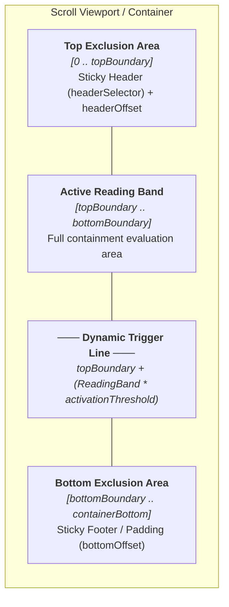

An anchor identifies a section of content independently of its pixel position. A scroll region defines which anchors `magicScroll` manages; the scroll container determines which viewport moves. Keeping these three roles separate helps you design layouts that remain navigable as content changes.

## Stable IDs identify content

The URL fragment `#project-12` refers to the element with ID `project-12`. On restoration, the library finds that element's current position. Inserting content above it can change its coordinates without changing what the link means.

Use IDs derived from the identity of your content, such as a project ID. An array index is unsuitable when sorting, filtering or inserting items can make it refer to a different item. IDs must be unique across the entire document, including across separate regions.

Restoration returns to an anchor's position with the configured top offset. It does not remember the exact pixel distance the user had scrolled into that section.

## Configuring activation boundaries and scroll offsets

`magicScroll` computes both scroll alignment and active section detection using layout and offset configuration:

- **`headerOffset`**: Static spacing in pixels (e.g. `headerOffset: 24`), adding visual breathing room above section headings.
- **`headerSelector`**: CSS selector for a fixed or sticky navigation bar (e.g. `headerSelector: '.app-header'`). Its dynamically measured height is automatically added to the boundary offset so obscured elements do not trigger activation or get covered during scroll restoration.
- **`bottomOffset`**: Static bottom spacing in pixels (e.g. `bottomOffset: 40`), accounting for sticky footers, floating action bars, or aesthetic margins.
- **`activationThreshold`**: Relative focal trigger threshold from `0.0` (top boundary) to `1.0` (bottom boundary), defining the trigger line (`topBoundary + (bottomBoundary - topBoundary) * activationThreshold`) where sections transition to active status.

Active section detection evaluates elements within the visible reading area between the effective top boundary (`containerTop + headerHeight + headerOffset`) and bottom boundary (`(containerBottom | viewportHeight) - bottomOffset`), prioritizing fully visible sections before falling back to reading-position tracking for tall content relative to the configured `activationThreshold`.



You can configure offsets globally in application providers or locally per scroll region:

```ts
// Global configuration
provideMagicScroll({
  headerSelector: '.app-header',
  headerOffset: 24,
  bottomOffset: 48,
  activationThreshold: 0.3,
});
```

```html
<!-- Per-region override -->
<div magicScroll [scrollOptions]="{ headerOffset: 16, bottomOffset: 32, activationThreshold: 0.5 }">
  ...
</div>
```

## A region selects its anchors

By default (`anchorSelection: 'all'`), all descendant elements with non-empty IDs participate. This includes IDs on headings or form controls, so a region can contain more anchors than your section navigation exposes.

Use `anchorPrefixes` to restrict automatic selection, and `scrollAnchor` to explicitly include an element even when its ID does not match the prefix:

```html
<div magicScroll [scrollOptions]="{ anchorPrefixes: ['project-', 'milestone-'] }">
  <section id="overview" scrollAnchor>Overview...</section>
  <section id="project-planning">
    <h2 id="planning-heading">Planning</h2>
  </section>
  <section id="milestone-alpha">Alpha release...</section>
  <section [scrollAnchor]="'project-delivery'">Delivery...</section>
</div>
```

The anchors here are `overview`, `project-planning`, `milestone-alpha` and `project-delivery`. The heading's ID (`planning-heading`) is excluded because it matches neither prefix. The bound marker `[scrollAnchor]` also assigns the element's ID; import `ScrollAnchorDirective` when using either marker form.

### Multiple prefixes and strict explicit selection

`magicScroll` provides versatile selection strategies:

- **`anchorPrefixes`**: Specify an array of prefixes (e.g. `['project-', 'milestone-']`). Any descendant element whose ID begins with any of these prefixes participates, along with explicit `scrollAnchor` elements. Passing an empty array `anchorPrefixes: []` disables all prefix matching, allowing only explicit `scrollAnchor` markers to participate.
- **`anchorSelection: 'explicit'`**: Enables strict explicit-only mode. In this mode, **only** elements explicitly marked with `scrollAnchor` or `[scrollAnchor]` participate in scroll-spy, initial restoration and `scrollTo()`. All other IDs—including auto-generated IDs from component libraries such as Angular Material (`mat-input-*`, `cdk-describedby-*`) or nested form controls—are strictly ignored, even if they match configured prefixes.
- **`anchorSelection: 'all'` (default)**: Descendant elements matching any configured `anchorPrefixes` (or all descendant IDs if no prefix is set) as well as explicit `scrollAnchor` markers participate.

```ts
// Example: Strict explicit selection across the application
provideMagicScroll({
  anchorSelection: 'explicit',
});
```

```html
<!-- Per-region override supporting multiple prefixes -->
<div magicScroll [scrollOptions]="{ anchorPrefixes: ['doc-', 'appendix-'] }">
  ...
</div>
```

The same selection applies to scroll-spy tracking, initial restoration and `scrollTo()`. An element can exist in the DOM and still be unavailable to this region because it is excluded by the selection rules. Setting `anchorPrefixes: ['']` on a region clears an inherited prefix and includes all its descendant IDs again.

## Each anchor belongs to its closest region

With nested `magicScroll` regions, each anchor belongs to the closest region containing it. The outer region excludes anchors inside the inner region, even if their IDs match its prefix or have explicit markers.

For example, an outer article can manage its section headings while an inner list manages its items. Calling the outer region's `scrollTo()` with an inner item ID returns `false`. Call the directive instance that owns the target instead.

Region ownership separates target selection. It does not create independent URL state: a route has one fragment, and regions connected to that route share it. Plan which region should control shareable navigation when multiple regions are active.

## The region and scroll container can be different elements

`magicScroll` chooses the container from the layout:

1. The region host itself, if its computed vertical overflow is `auto` or `scroll`.
2. Otherwise, the closest ancestor with either overflow value.
3. Otherwise, the document.

CSS supplies the height constraints and overflow that make that container scroll. Adding `magicScroll` alone does not create a scrolling viewport.

A detail region can therefore scroll with the document while a companion sidebar scrolls independently. If the sidebar sits outside the region, its IDs do not become detail anchors. Conversely, placing the region inside a constrained drawer makes the drawer content the scroll container.

## Related documentation

- [URL state and navigation](../url-state-and-navigation/) explains how selected anchors become URL state.
- [Anchor navigation](../../recipes/scroll-to-anchor/) implements prefix selection, markers and navigation highlighting.
- [Angular Material Drawer](../../recipes/material-drawer/) shows a constrained scroll container.
- [MagicScrollDirective](../../api/classes/magicscrolldirective/) and [ScrollAnchorDirective](../../api/classes/scrollanchordirective/) document the directive APIs.
