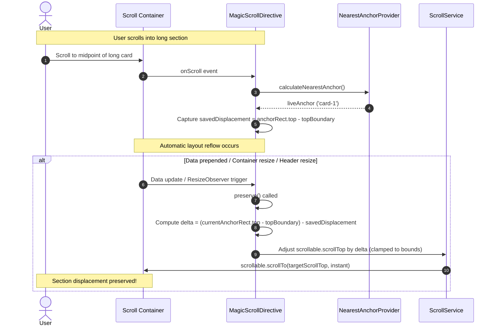

After initial restoration, content and layout can shift dynamically due to asynchronous data insertions, container resizing, or sticky header height changes. `ngx-magic-scroll` implements an **anchor-relative pixel displacement policy** that preserves the active section's pixel displacement, preventing disruptive jumps back to section headings during automatic reflows.

## Different causes have different policies

| Cause                                          | Target                       | Displacement policy                                      | Default behavior                                                |
| ---------------------------------------------- | ---------------------------- | -------------------------------------------------------- | --------------------------------------------------------------- |
| Initial ready render                           | Fragment from URL snapshot   | Aligned to heading (`displacement = 0`)                  | Restore once, instantly (unless user cancelled via interaction) |
| Explicit `scrollTo()`                          | Requested anchor             | Aligned to heading (`displacement = 0`)                  | Scroll smoothly                                                 |
| External router fragment change                | Route destination anchor     | Aligned to heading (`displacement = 0`)                  | Restore instantly                                               |
| Later ready source change                      | Current live visible section | Preserves saved pixel displacement (`savedDisplacement`) | Correct instantly without resetting to section top              |
| Window resize or measured header-height change | Current live visible section | Preserves saved pixel displacement (`savedDisplacement`) | Realign instantly to maintain section pixel offset              |

The distinction between initial URL fragments, live visible sections, and intentional user navigation ensures seamless reading continuity. When reading halfway through a 1200px card, layout reflows preserve the section's relative pixel position rather than resetting to the card header.

### Live section tracking vs URL debouncing

While scrolling, the active visible section geometry and anchor-relative pixel displacement are captured in real time, whereas updates to the browser's URL router are debounced by `debounceTime` (default 500ms) to avoid cluttering browser history during continuous motion. When automatic realignment or data updates occur during this debounce interval, `ngx-magic-scroll` preserves the real-time visible section and displacement rather than falling back to a stale URL anchor.



## Section-relative displacement mechanics

### 1. Displacement capture during user scrolling

As the user scrolls through the container, `onScroll` computes the reading boundary and measures the active section's top offset:

```text
topBoundary = containerTop + measuredHeaderHeight + headerOffset
savedDisplacement = activeAnchorElement.getBoundingClientRect().top - topBoundary
```

For example, when reading 400px deep into a card, `savedDisplacement` is `-400px`.

### 2. Delta calculation and native scroll anchoring compatibility

When automatic reflow occurs (e.g. items prepended above the section, or sticky header expanded):

```text
currentDisplacement = currentAnchorElement.getBoundingClientRect().top - topBoundary
delta = currentDisplacement - savedDisplacement
targetScrollTop = clamp(currentScrollTop + delta, 0, maxScrollTop)
```

- **Without browser scroll anchoring:** If content is inserted above the section, `currentDisplacement` changes by the height of the prepended items. `delta` equals the shift and `scrollTop` is adjusted instantly, keeping the section visually locked under the reader's view.
- **With native browser scroll anchoring (`overflow-anchor: auto`):** If the browser has already compensated `scrollTop` for inserted content, `currentDisplacement` remains equal to `savedDisplacement`. `delta` computes to `0`, inherently preventing double-compensation without browser-sniffing heuristics.
- **Intra-section limitation:** Anchor-relative displacement preserves the active section anchor's pixel offset relative to the reading boundary (`savedDisplacement`). It does not track intra-section elements or percentage progress through a section. Consequently, when text wraps or content changes _inside_ the active section itself, the exact paragraph or sentence being read may still move; retaining a specific paragraph across internal changes requires finer-grained child anchors.

### 3. Reset policy for deliberate navigation

Explicit programmatic calls (`scrollTo('card-2')`) and external router fragment navigations reset `savedDisplacement` to `0`. Intentional navigation always aligns the destination section's heading cleanly to the configured top offset.

### 4. Deterministic element removal handling

If the active section element is removed from the DOM during a data change or layout update, `preserve()` gracefully skips realignment and maintains the current viewport position without arbitrary jumps.

## Header measurement defines the top offset

The effective top offset boundary is:

```text
measured header height + headerOffset
```

With no configured or matching header, the measured height is zero and `headerOffset` supplies the entire offset. With a header, it adds a gap below that header. Use a `headerSelector` that uniquely identifies the intended element; its height is measured and observed automatically via `ResizeObserver`.

`offset()` exposes the sum, and `headerHeight()` exposes the measurement alone. A sticky companion panel can use the same sum for its CSS `top` so navigation and scroll alignment share one boundary.

A per-call `topOffset` replaces the entire effective offset for that action. It is not an additional gap. Viewport boundary clamping ensures scroll targets are bounded within `[0, scrollHeight - clientHeight]`.

## Choose a policy for your layout

Use `restoreOnDataChange: false` when data updates should let the viewport move naturally without anchor preservation. Use `preserveOnResize: false` when automatic realignment during resizing or header changes is unwanted. Disabling layout corrections still leaves the measured header height and effective offset available.

Initial restoration and explicit interactions have separate behavior defaults: `behavior.restoration` is `instant`, and `behavior.interaction` is `smooth`. Automatic data and layout corrections remain instant.

Provider defaults are inherited through Angular's injector hierarchy. Region `scrollOptions` override those defaults, and supported per-call options override the region for one `scrollTo()` action.

## Related documentation

- [Data readiness and restoration](../data-readiness-and-restoration/) explains initial restoration, user cancellation, and the event lifecycle diagram.
- [Sticky master–detail](../../recipes/sticky-master-detail/) shares the measured offset with a sticky sidebar.
- [Paginated lists](../../recipes/paginated-lists/) shows data updates and optional correction disabling.
- [MagicScrollOptions](../../api/interfaces/magicscrolloptions/) documents configuration defaults and visibility rules.
- [MagicScrollToOptions](../../api/type-aliases/magicscrolltooptions/) documents per-action overrides.
