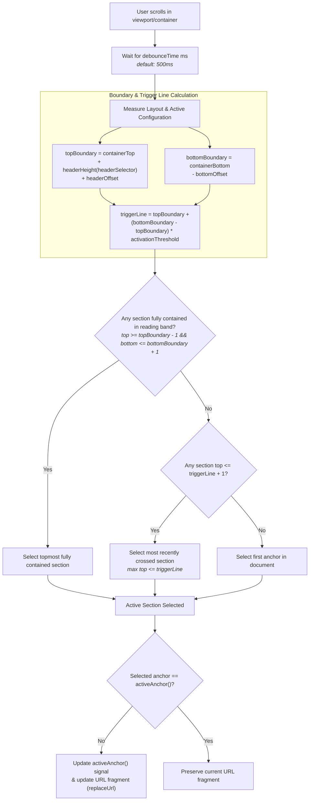
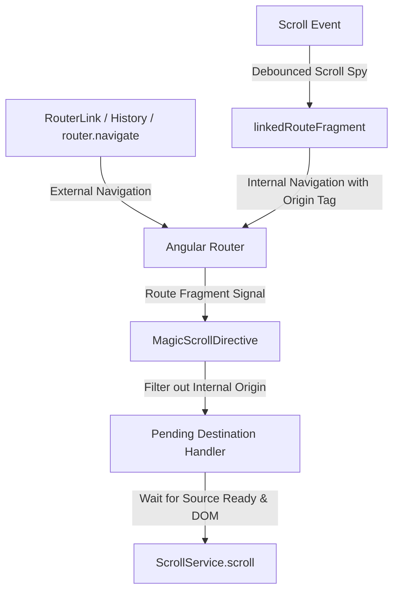

The route fragment is the shared anchor identifier used by scroll tracking, explicit navigation and restoration. These operations use it at different times: scrolling records an anchor, `scrollTo()` requests movement, and a newly created region captures the fragment for initial restoration.

## Scrolling records an anchor

After scrolling settles, the region determines which section the user is currently reading based on an evaluated visible reading area and a hybrid evaluation model:

- **Top boundary (`topBoundary`)**: `containerTop + headerHeight + headerOffset`
  - For document scrolling, `containerTop` is `0`.
  - For nested scrollable containers (`overflow: auto | scroll`), `containerTop` is the container's top edge (`getBoundingClientRect().top`).
  - With `headerSelector`, sticky header height is measured and added dynamically.
  - With `headerOffset`, custom pixel padding or trigger line offsets are included.
- **Bottom boundary (`bottomBoundary`)**: `(isDocument ? window.innerHeight : containerBottom) - bottomOffset`
  - With `bottomOffset`, bottom margins or space occupied by sticky footers and bottom floating bars are excluded from the active evaluation window.
- **Trigger line (`triggerLine`)**: `topBoundary + (bottomBoundary - topBoundary) * activationThreshold`
  - With `activationThreshold` (`0.0` to `1.0`, default `0.0`), developers can position the active trigger focal line anywhere across the visible reading band (e.g. `0.3` for upper-third reading focus, `0.5` for center trigger).

### Evaluation Priority

1. **Fully Contained Sections (Full Containment Elevation)**: If an upcoming section is 100% visible within the reading area (`top >= topBoundary - 1` and `bottom <= bottomBoundary + 1`), it becomes active immediately—even if a small tail of the previous section is still visible at the top. If multiple sections are fully visible, the topmost fully contained section is selected.
2. **Tall Section Reading Retention (Reading Line Fallback)**: For sections that are taller than the viewport (or long multi-paragraph articles), the section remains active while scrolling through its body (`top <= triggerLine + 1`) until a subsequent section crosses the trigger line or becomes fully visible.
3. **Top of Page Fallback**: When scrolled above all anchors, the first anchor is selected.



Scroll-spy updates are debounced by 500 ms by default (`debounceTime`). During continuous movement, the fragment can therefore lag behind the viewport until scrolling pauses. If there are no eligible candidates, the existing fragment remains unchanged.

`activeAnchor()` exposes the current fragment as a signal and reacts to route-fragment changes. Use it to highlight active navigation links and scroll-spy indicators.

## Explicit navigation requests movement

For a user action within an existing region, call `scrollTo()` on that region:

```html
<button (click)="scroll.scrollTo('project-12')">Show project 12</button>
<div magicScroll #scroll="magicScroll">
  <section id="project-12">Project 12...</section>
</div>
```

The target must already be rendered and selected by the region. By default, the call initiates smooth scrolling and updates the fragment. Its boolean return value reports whether scrolling was initiated, not whether the animation has finished.

A call returns `false` when the target is missing, excluded, owned by another region or skipped by the configured visibility rule. A skipped call does not itself update the fragment. Data readiness does not queue explicit calls for later execution.

## Initial restoration reads the entry fragment

When a region is created, it captures the route's current fragment. Once its content is ready and rendered, it attempts to restore that anchor once. This supports opening a section link, reloading it or returning to a routed list whose region is recreated.

See [Data readiness and restoration](../data-readiness-and-restoration/) for the timing and missing-target behavior.

## Subsequent router fragment navigation

When external router navigation changes the URL fragment subsequently (e.g. via `[routerLink]`, programmatic `router.navigate()`, or browser history Back/Forward navigation), `MagicScrollDirective` automatically restores the scroll position to the target anchor using `behavior.restoration`.

To prevent feedback loops between user-driven router navigations and the automatic scroll-spy, the library uses internal origin discrimination:



## URL updates preserve the current history entry

Library fragment updates preserve query parameters and use Angular Router's `replaceUrl`. Scrolling through sections therefore updates the current history entry instead of creating a new entry for every anchor.

For a list-to-detail round trip, these roles are complementary:

1. The list's fragment records the item to return to.
2. Navigation to the detail page creates the next history entry.
3. Browser Back returns to the list URL, and the recreated region restores its fragment.

If clicking an item should define the return target, record that item's fragment before leaving and await the URL update. The debounced scroll spy may still name another item at click time. Query parameters can separately preserve filters or the loaded data range; the fragment identifies the section within that restored state.

## Related documentation

- [Return to a list](../../recipes/return-to-list/) implements the history sequence and an explicit return link.
- [Anchor navigation](../../recipes/scroll-to-anchor/) builds navigation highlighting and per-action overrides.
- [Scroll regions and anchor identity](../anchors/) explains eligible targets and shared fragment state.
- [MagicScrollDirective](../../api/classes/magicscrolldirective/) documents `activeAnchor()` and `scrollTo()`.
