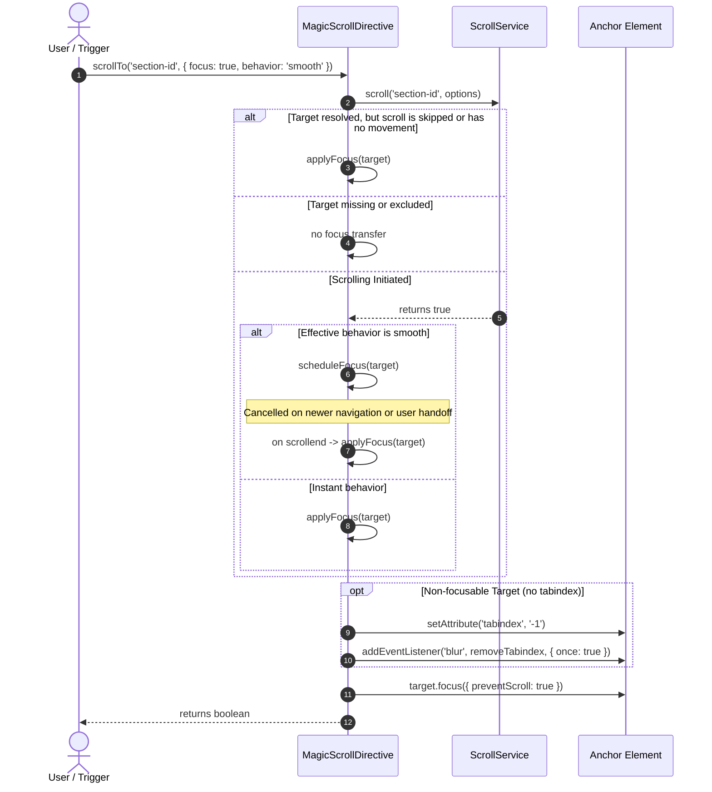

## Goal

Build a small section navigation that scrolls on click and highlights the current section as the user scrolls.

## Solution

Start with an Angular application that provides Router, as described in [Getting started](../../getting-started/). This complete component uses static content:

<!-- recipe-check: scroll-to-anchor-0.ts -->

```ts
import { Component } from '@angular/core';
import {
  MagicScrollDirective,
  ScrollAnchorDirective,
  provideMagicScroll,
} from '@devzwo/ngx-magic-scroll';

@Component({
  selector: 'app-project-sections',
  imports: [MagicScrollDirective, ScrollAnchorDirective],
  providers: [provideMagicScroll({ anchorPrefixes: ['project-'] })],
  template: `
    <nav aria-label="Project sections">
      @for (id of sections; track id) {
        <button
          [attr.aria-current]="scroll.activeAnchor() === id ? 'location' : null"
          (click)="scroll.scrollTo(id)"
        >
          {{ id }}
        </button>
      }
    </nav>

    <div magicScroll #scroll="magicScroll">
      <section id="overview" scrollAnchor>
        <h2>Overview</h2>
      </section>
      <section id="project-planning">
        <h2>Planning</h2>
        <h3 id="planning-notes">Notes</h3>
      </section>
      <section [scrollAnchor]="'project-delivery'">
        <h2>Delivery</h2>
      </section>
    </div>
  `,
  styles: `
    section {
      min-height: 70vh;
    }
    button[aria-current='location'] {
      font-weight: bold;
    }
  `,
})
export class ProjectSectionsComponent {
  readonly sections = ['overview', 'project-planning', 'project-delivery'];
}
```

`anchorPrefixes` includes the project sections and excludes unrelated IDs such as `planning-notes`. The explicit `scrollAnchor` includes `overview` despite its different prefix; the bound form also assigns the element's ID. Without a prefix, all descendant IDs participate and the markers are optional.

`scrollTo()` scrolls smoothly by default and synchronizes the fragment. `activeAnchor()` exposes that fragment; scroll-spy updates use a 500 ms debounce by default. IDs must be unique in the document and remain stable across renders.

### Override one interaction

For a particular button, pass per-call options:

```html
<button
  (click)="scroll.scrollTo('project-delivery', {
    behavior: 'instant',
    ignoreWhenInView: 'full'
  })"
>
  Show delivery if it is not fully visible
</button>
```

`scrollTo()` returns `false` when the target is unavailable, outside this region, excluded by anchor selection or skipped by the visibility rule. Each anchor belongs to its closest `magicScroll` region, so a parent cannot scroll to a nested region's anchors.

### Accessible focus transfer

When navigating via keyboard shortcuts, skip links, or error notifications, transferring DOM focus to the target element is critical for accessibility. Pass `{ focus: true }` to `scrollTo()` to transfer keyboard focus without secondary layout shifts:

```html
<button
  (click)="scroll.scrollTo('project-delivery', {
    behavior: 'smooth',
    focus: true
  })"
>
  Jump to delivery and shift focus
</button>
```

- **Safe Focus**: Invocations use `focus({ preventScroll: true })` so browser-native focus scrolling does not conflict with calculated header offsets.
- **Temporary Tabindex Management**: Naturally focusable elements (links, buttons, inputs) and elements with existing `tabindex` receive focus directly. Non-focusable container elements (e.g. `<section>`, `<div>`) receive a temporary `tabindex="-1"`, which is removed if focus fails, on `blur`, or when the directive is destroyed. Consumer changes to `tabindex` are preserved.
- **Smooth Scroll Coordination & Cancellation**: For effective smooth scrolling (including `behavior: 'auto'` when CSS `scroll-behavior` is smooth), focus is applied upon scroll completion (`scrollend`). No-movement requests focus immediately. A newer navigation, user scroll, Tab key, focus change, or pointer handoff cancels stale pending focus.
- **Target validation**: The target must still be connected and eligible in this region when focus is applied. Pending focus is canceled if scrolling does not complete within five seconds.



## Scope and related recipes

The target must already be rendered; this recipe does not load data or missing sections.

- [Return to a list](../return-to-list/) adds navigation between routed pages.
- [Angular rxResource](../rx-resource/) waits for asynchronously rendered anchors.
- [Sticky master–detail](../sticky-master-detail/) adds header offsets and sticky navigation.
- [Angular Material Drawer](../material-drawer/) moves scrolling into a nested container.
